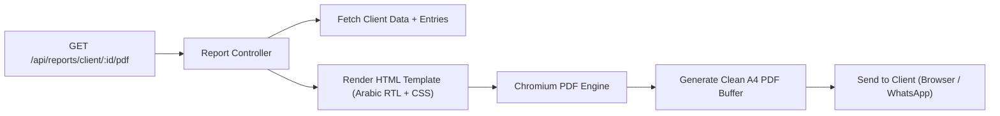

# Phase 2: PDF Reports & Account Statements Engine

## 🎯 Phase Goal
Design and build a high-fidelity PDF generation engine capable of creating clean, professional, printable account statements (A4 format) and transaction receipts with **native Arabic RTL support** (no reversed or disconnected letters). These documents can be printed directly or exported to share with customers via WhatsApp.

---

## 📄 Document Specifications

### 1. Client Statement (`كشف حساب الكليان`)
- **Header**:
  - Shop name / Merchant name (`اسم المحل`)
  - Contact phone number
  - Generated date and time
- **Client Information Block**:
  - Client Full Name (`اسم الزبون`)
  - Phone number
  - Address / Note
- **Financial Summary Box**:
  - Total Debts Taken (`مجموع ما أخذ`)
  - Total Payments Made (`مجموع ما دفع`)
  - **Net Outstanding Balance** (`الباقي الواجب أداؤه`) — prominently highlighted in red/green
- **Transactions Table (Chronological Order)**:
  - Date (`التاريخ`)
  - Type (`النوع`: كريدي / دفعة)
  - Description / Items (`البيان / السلعة`)
  - Amount (`المبلغ بالدرهم`)
- **Footer**:
  - Custom note (e.g. *شكراً لتعاملكم معنا*)
  - Signature line

### 2. General Store Debts Report (`تقرير الديون العام`)
- Comprehensive overview of all active debtors, their last transaction date, and remaining balance for accounting and inventory audits.

---

## 🛠️ Technical Solution for Arabic RTL PDF

### Challenge:
Standard PDF libraries in Node.js often struggle with Arabic script shaping, ligatures, and bidirectional text (rendering letters backwards or disconnected).

### Recommended Architecture:
Use **Headless HTML-to-PDF** via **Puppeteer** or **Playwright / chrome-headless**:
1. Render an HTML template with full CSS styling, modern typography (`@import url('fonts/Cairo.css')`), and native `dir="rtl"`.
2. Chromium renders the Arabic text natively with 100% correct font shaping, ligatures, and bidirectional punctuation.
3. Convert the page to A4 PDF buffer and stream directly to the client browser or mobile download.

---

## 🔌 API Endpoints Specification

| Method | Endpoint | Description | Query Parameters | Output |
|---|---|---|---|---|
| `GET` | `/api/reports/client/:id/pdf` | Generate statement PDF for client | `?from=YYYY-MM-DD&to=YYYY-MM-DD` | `application/pdf` stream with `Content-Disposition: inline; filename="credet-client-id.pdf"` |
| `GET` | `/api/reports/general/pdf` | Summary PDF of all active balances | `?filter=debt_only` | `application/pdf` stream |

---

## 📋 Task Checklist for Phase 2

- [ ] Select and install the PDF generator module (`puppeteer` or lightweight Chromium runner).
- [ ] Embed Arabic Google Font (`Cairo` / `IBM Plex Sans Arabic`) locally in the template assets so PDF generation does not depend on an internet connection.
- [ ] Create clean, printable HTML/CSS statement template (`src/templates/statement.html`) with RTL support.
- [ ] Implement `src/services/pdfService.js` to populate data into template and generate PDF buffer.
- [ ] Create route handler `/api/reports/client/:id/pdf`.
- [ ] Verify Arabic text rendering (ligatures, diacritics, RTL table alignment, currency formatting in DH).
- [ ] Add print-optimized CSS rules (`@media print`, page breaks, margin settings).

---

## ✅ Acceptance Criteria
1. PDF renders correctly in Arabic RTL without any disconnected, flipped, or missing characters.
2. Tables split cleanly across multiple pages if a client has dozens of transactions.
3. Generation time under 1.5 seconds per PDF.
4. Downloadable directly from both Web browser and Mobile app.
