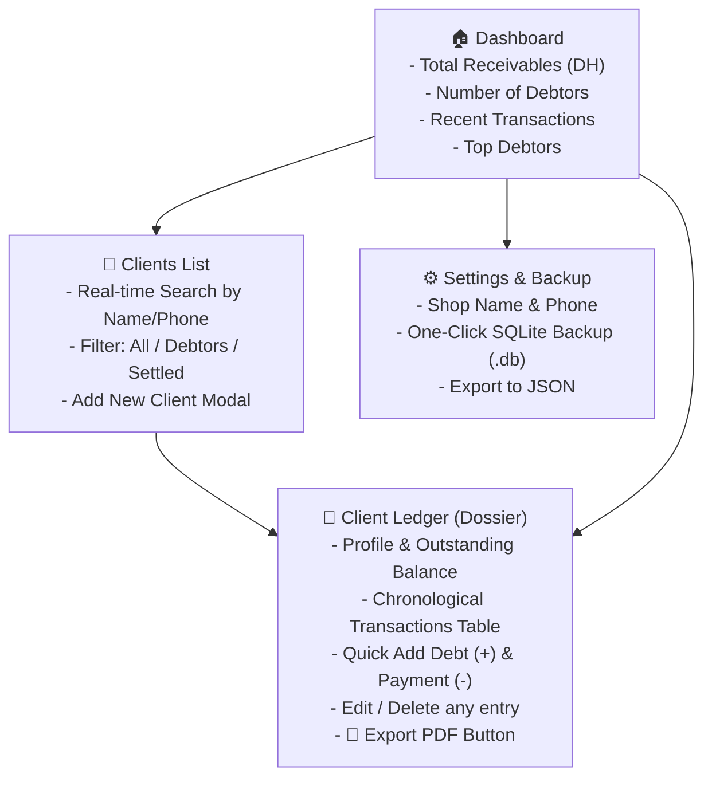

# Phase 3: Web Application (Next.js 14)

## 🎯 Phase Goal
Develop a fast, modern, and accessible Web Application using **Next.js 14** tailored for the shopkeeper/lender. The user interface will be fully localized in **Arabic with native RTL layout**, prioritizing speed of data entry, clarity of balances, and instantaneous search.

---

## 🎨 UI/UX Design System

### Layout & Orientation
- **HTML Direction**: `<html dir="rtl" lang="ar">`
- **Typography**: Google Font `Cairo` or `IBM Plex Sans Arabic` for text; `JetBrains Mono` or tabular numerals for amounts and balances.
- **Theme**: Sleek dark mode (`#0B0F19` background, `#161F30` elevated cards, `#1E293B` borders) with vibrant semantic accent colors:
  - 🔴 **Debt / Receivable**: `#EF4444` (Crimson Red)
  - 🟢 **Payment / Settled**: `#10B981` (Emerald Green)
  - 🟣 **Primary Action**: `#6366F1` (Indigo / Violet)
  - 🟡 **Warning / Partial**: `#F59E0B` (Amber)

---

## 🖥️ Screen Architecture & User Flows

---

## 📱 Detailed Screen Specifications

### 1. 🏠 Dashboard (`/`)
- **Key Metrics (Metric Cards)**:
  - **Total Unpaid Debts** (`إجمالي الديون القائمة`): Sum of all positive client balances in Moroccan Dirhams (DH).
  - **Active Debtors Count** (`عدد الكليان المدينين`).
  - **Payments Collected Today** (`المداخيل المسترجعة اليوم`).
- **Quick Actions Bar**:
  - `[+] إضافة كليان جديد` (Add Client).
  - `[+] تسجيل كريدي سريع` (Quick Add Debt).
- **Recent Transactions Feed**:
  - Live list of the last 10 entries across all clients with clickable client names.

### 2. 👥 Clients Directory (`/clients`)
- **Search Bar**: Debounced instant search filtering by name, phone, or neighborhood.
- **Segmented Tabs**: `الكل` (All), `عليهم كريدي` (With Debt), `خالصين` (Settled).
- **Client Card Component**:
  - Client Name & Avatar initials.
  - Phone number with direct `tel:` and WhatsApp links (`https://wa.me/...`).
  - Outstanding balance badge:
    - If `> 0`: Red badge with amount (e.g. `1,250.00 DH`).
    - If `= 0`: Green badge (`الحساب خالص`).
  - Click anywhere on card navigates to Client Ledger.

### 3. 📁 Client Ledger View (`/clients/[id]`)
- **Header**:
  - Client details (Name, Phone, Address, Notes).
  - Prominent Balance Card showing:
    - Total Taken (`مجموع ما أخذ`)
    - Total Paid (`مجموع ما دفع`)
    - Net Outstanding (`الباقي الصافي الواجب أداؤه`)
  - Action Buttons:
    - 🔴 `[+] تسجيل كريدي` (Record Debt)
    - 🟢 `[-] تسجيل دفعة / تسديد` (Record Payment)
    - 📄 `تحميل كشف حساب PDF` (Export PDF)
- **Transactions Timeline / Table**:
  - Columns: Date | Type Badge | Description / Goods | Amount | Actions (Edit / Delete)
  - Clicking **Edit** opens modal with pre-filled values.
  - Clicking **Delete** opens confirmation dialogue to prevent accidental deletion.
  - Balance recalculates in real-time on UI upon any change.

### 4. ⚙️ Settings & Data Backup (`/settings`)
- Shop name and phone for PDF branding.
- **Backup Section**:
  - Button: `💾 تحميل نسخة احتياطية من قاعدة البيانات (credet.db)`.
  - Button: `📥 استرجاع نسخة احتياطية (Restore Database)`.

---

## ⚡ Speed & Usability Considerations (UX Optimization)
- When opening the **Add Debt / Add Payment** modal:
  - The **Amount** field is automatically focused.
  - Virtual/mobile keypad defaults to numeric (`inputMode="decimal"`).
  - Date defaults to current moment automatically.
  - Form submits with `Enter` key for desktop rapid entry.

---

## 📋 Task Checklist for Phase 3

- [ ] Initialize Next.js 14 project in `web/` with App Router.
- [ ] Setup Arabic typography (`Cairo` / `IBM Plex Sans Arabic`), RTL configuration, and color tokens.
- [ ] Build reusable UI primitives: `Button`, `Input`, `Modal`, `Badge`, `ConfirmDialog`, `StatCard`.
- [ ] Implement API client service (`src/lib/api.ts`) connecting to Backend.
- [ ] Build Dashboard page (`app/page.tsx`).
- [ ] Build Clients list page with real-time search & filters (`app/clients/page.tsx`).
- [ ] Build Client Ledger page (`app/clients/[id]/page.tsx`) with entry CRUD modals.
- [ ] Integrate PDF download trigger with progress feedback.
- [ ] Build Settings & Backup management page (`app/settings/page.tsx`).

---

## ✅ Acceptance Criteria
1. Full application runs in Arabic with flawless RTL alignment.
2. Searching for a client among hundreds is instantaneous (sub-50ms).
3. Adding, editing, and deleting an entry updates ledger and totals with zero page reloads.
4. Fully responsive layout that looks great on laptops, tablets, and desktop displays.
