# Phase 4: Mobile Application (React Native / Expo)

## 🎯 Phase Goal
Develop a native mobile application using **React Native & Expo** designed for the merchant on the go. The app connects to the same backend API, offering touch-first navigation, instant numeric input for busy moments in the store, and one-tap WhatsApp account statement sharing.

---

## 📱 Mobile-Specific Features & UX

```mermaid
graph TD
    subgraph BottomTabs["Bottom Navigation Bar"]
        T1["🏠 Home<br/>الرئيسية"]
        T2["👥 Clients<br/>الكليان"]
        T3["➕ Quick Entry<br/>تسجيل سريع"]
        T4["⚙️ Settings<br/>الإعدادات"]
    end

    T1 --> S1["Summary Cards + Recent Entries"]
    T2 --> S2["Clients List with Search & Balance Badges"]
    S2 --> S3["Client Ledger Screen"]
    S3 --> S4["Share Statement via WhatsApp"]
    S3 --> S5["Direct Phone Call (tel:)"]
    T3 --> S6["Instant Add Modal (Autofocus Numberpad)"]
    T4 --> S7["Database Backup & Server URL Config"]
```



---

## 🛠️ Technical Stack & Architecture

- **Framework**: React Native with **Expo (Managed Workflow)**.
- **Routing**: **Expo Router** (file-based navigation with native gestures and tabs).
- **Internationalization**: Full Arabic RTL support via React Native `I18nManager` (`I18nManager.forceRTL(true)`).
- **Network & State**: **TanStack Query (React Query)** for caching, optimistic UI updates, and background re-fetching.
- **Device Integrations**:
  - `expo-sharing` & `expo-file-system`: For saving and sharing the generated PDF statements.
  - `expo-linking`: For initiating phone calls and opening WhatsApp with pre-filled debt reminder messages.
  - `expo-haptics`: Subtle vibration feedback on transaction addition, modification, or deletion.

---

## 💬 WhatsApp Integration Specification

From the client ledger screen, the admin can tap **"إرسال كشف الحساب عبر واتساب"**:
1. Generates an automated friendly Arabic message:
   ```text
   السلام عليكم سي [اسم الكليان]،
   هذا كشف حسابك من [اسم المحل]:
   - مجموع الديون: [X] درهم
   - مجموع المدفوع: [Y] درهم
   - الباقي الصافي: [Z] درهم
   شكراً لتعاملكم معنا.
   ```
2. Automatically attaches the PDF statement file or sends the text link directly to the client's phone number via `whatsapp://send?phone=[PHONE]&text=[ENCODED_MESSAGE]`.

---

## 📋 Task Checklist for Phase 4

- [ ] Initialize mobile project with Expo in `mobile/`.
- [ ] Configure RTL layout support (`app.json`, `I18nManager`) and Arabic fonts (`Cairo`).
- [ ] Build custom theme tokens (Dark theme matching web client, high contrast).
- [ ] Set up API client with configurable base URL (to connect to localhost / local Wi-Fi IP).
- [ ] Implement Bottom Tab layout (`app/(tabs)/_layout.tsx`):
  - Home Dashboard tab
  - Clients list tab
  - Quick Entry modal
  - Settings & Server Connection tab
- [ ] Implement Client Ledger screen (`app/client/[id].tsx`):
  - Balance overview banner
  - Swipeable transaction rows (swipe to delete/edit)
  - Quick action floating buttons
- [ ] Implement WhatsApp sharing and Phone dialing integrations.
- [ ] Test on Android and iOS simulators / physical devices with Expo Go.

---

## ✅ Acceptance Criteria
1. Flawless Arabic RTL layout and typography across all screens on both Android and iOS.
2. Numeric keypad opens automatically when recording amounts.
3. Adding, editing, and deleting an entry reflects immediately with haptic confirmation.
4. Exported PDF opens smoothly in the native PDF viewer and shares directly to WhatsApp.
